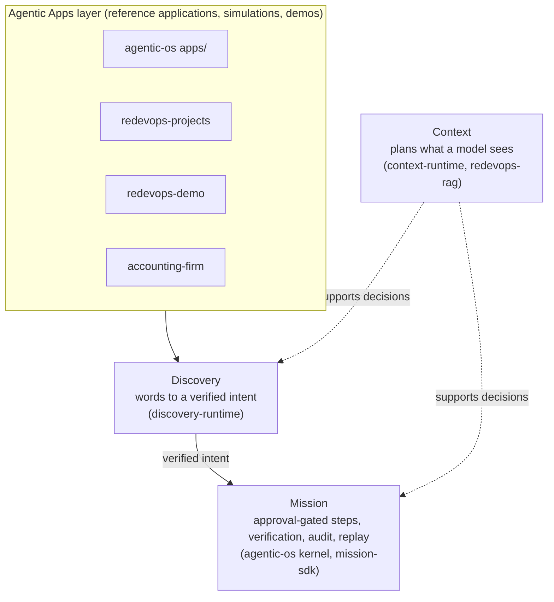

# ReDevOps

**ReDevOps provides a governed execution runtime for AI applications, with explicit context planning, discovery, approvals, verification, and replay.**

This page is a map of the public repositories, what each one is, and how mature each one is. Maturity labels are conservative.

## How the pieces fit

- **Discovery** turns a requester's words into a verified intent, which is then handed to a Mission.
- **Mission** executes a plan in steps behind approval gates, verifies outcomes, and records an audit trail that can be replayed.
- **Context** plans what a model sees; it supports decisions in both Discovery and Mission rather than sitting in the main flow.
- **Agentic Apps** sit on top and use the layers below. Shared schemas and golden fixtures live in `runtime-contracts`.

## Start here

1. **10-minute example (SDK, no provider key, no network once installed):** [`mission-sdk`](https://github.com/redevops-io/mission-sdk#readme). Install notes are in its README and [`QUICKSTART.md`](https://github.com/redevops-io/mission-sdk/blob/main/QUICKSTART.md); the runnable minimal example is [`examples/00_minimal/main.py`](https://github.com/redevops-io/mission-sdk/blob/main/examples/00_minimal/main.py). `mission-sdk` is labelled alpha and is not published to PyPI; install from git as its README describes.
2. **Full-stack demo (higher resource needs):** the self-hosted control plane in [`agentic-os` Quickstart](https://github.com/redevops-io/agentic-os#quickstart) (`docker compose up -d`, control plane on `:8080`). It starts a multi-service stack and needs noticeably more CPU, memory and setup than the SDK example; model endpoints and any API keys are your own. [`redevops-demo`](https://github.com/redevops-io/redevops-demo) is a separate multi-cloud deploy-and-operate demo that is simulation-first; it is not the quickstart.

## Repository directory

Only public repositories are listed. Licences vary by repository; see each repository's `LICENSE`.

### Core

| Repository | What it is | Maturity |
|---|---|---|
| [agentic-os](https://github.com/redevops-io/agentic-os) | Control plane, cost-aware LLM router, permissions plane, Mission kernel, and a bundle of reference apps | reference |
| [runtime-contracts](https://github.com/redevops-io/runtime-contracts) | Canonical schemas, hashing, golden fixtures, adoption manifest | reference; its README says implementation adoption is pending |
| [context-runtime](https://github.com/redevops-io/context-runtime) | Query planner for LLM context (default branch `v4`) | reference (README: "runnable reference implementation") |
| [discovery-runtime](https://github.com/redevops-io/discovery-runtime) | Intent-discovery runtime: words to a sealed, verified intent | reference |
| [redevops-rag](https://github.com/redevops-io/redevops-rag) | Hybrid retrieval library and CLI (DuckDB) | reference |

### SDK

| Repository | What it is | Maturity |
|---|---|---|
| [mission-sdk](https://github.com/redevops-io/mission-sdk) | `redevops-mission` package and `rdo` CLI over the Mission runtime | alpha (README badge) |
| [redevops-connectors](https://github.com/redevops-io/redevops-connectors) | `IntegrationAdapter` contract and provider adapters | simulation-only (README: adapters run only against fixtures) |
| [agent-harness](https://github.com/redevops-io/agent-harness) | LLM client, tool registry, approvals, sandbox, guardrails, evals | reference; example runs against a stub client |
| [knowledge-frontier](https://github.com/redevops-io/knowledge-frontier) | "What to teach next" planner | simulation-only (tested on synthetic learners) |

### Integrations

| Repository | What it is | Maturity |
|---|---|---|
| [redevops-integrations](https://github.com/redevops-io/redevops-integrations) | Conformance slices around agent frameworks and cloud providers, using the Mission SDK | internally reproduced (committed result bundles; not independently re-run) |

### Applications

| Repository | What it is | Maturity |
|---|---|---|
| [redevops-projects](https://github.com/redevops-io/redevops-projects) | React front-end shell for the Projects workspace (README: phase P1 of P1-P10) | alpha |
| [redevops-demo](https://github.com/redevops-io/redevops-demo) | Multi-cloud deploy-and-operate demo | simulation-only (README: missions run sim-first, $0) |
| [accounting-firm](https://github.com/redevops-io/accounting-firm) | Composition demo on synthetic data (Section 41 study, ASC 606 memo, CPA-review console) | simulation-only |
| [sidekick](https://github.com/redevops-io/sidekick) | Local coding-agent orchestrator (DAG, git worktrees) | alpha |

### Research

| Repository | What it is | Maturity |
|---|---|---|
| [DataOpsBench](https://github.com/redevops-io/DataOpsBench) | Synthetic DataOps scenarios with deterministic gates | internally reproduced |
| [multiagent-orchestration-benchmark](https://github.com/redevops-io/multiagent-orchestration-benchmark) | Paired A/B tasks asking whether formal orchestration beats a strong supervisor; publishes a null result | internally reproduced |

### Forks and copies of third-party projects

These are not ReDevOps products. Maturity labels do not apply; refer to the upstream projects.

| Repository | Upstream | Note |
|---|---|---|
| [graphiti](https://github.com/redevops-io/graphiti) | getzep/graphiti | GitHub fork; see `FORK_NOTES.md` in the repo |
| [HippoRAG](https://github.com/redevops-io/HippoRAG) | OSU-NLP-Group/HippoRAG | GitHub fork |
| [openclaw](https://github.com/redevops-io/openclaw) | openclaw/openclaw | GitHub fork; see `FORK_README.md` in the repo |
| [ingress-nginx](https://github.com/redevops-io/ingress-nginx) | kubernetes/ingress-nginx | Not a GitHub fork (a detached copy); see its README |

Maturity labels used: alpha, reference, simulation-only, deployed internally, internally reproduced. None of the evidence in these repositories has been externally reproduced or field validated.

## Evidence and limitations

Each repository's README carries its own caveats. Existing READMEs with explicit limitations worth reading first: [redevops-connectors](https://github.com/redevops-io/redevops-connectors#readme) (fixtures only), [redevops-demo](https://github.com/redevops-io/redevops-demo#readme) (safety notes and simulation status), [multiagent-orchestration-benchmark](https://github.com/redevops-io/multiagent-orchestration-benchmark#readme) (null result).

**Evidence status:** preliminary; not independently validated.

## Licences

Licences vary by repository; see each repository's `LICENSE`. The titles below are taken from the repositories' own licence files and manifests. Nothing here is a legal conclusion.

| Repository | LICENSE title as it appears in the repo |
|---|---|
| agentic-os, runtime-contracts, discovery-runtime, redevops-connectors, redevops-projects, redevops-rag | AGPL-3.0 text plus Commons Clause; `LICENSE.md` reads "source-available, not open source". GitHub's licence label may show only AGPL-3.0 |
| context-runtime, sidekick, agent-harness, knowledge-frontier | AGPL-3.0 (sidekick, agent-harness, knowledge-frontier declare `-or-later`) |
| redevops-demo, accounting-firm | AGPL-3.0 (declared `AGPL-3.0-only` in package metadata) |
| mission-sdk, redevops-integrations, DataOpsBench | Apache-2.0 |
| multiagent-orchestration-benchmark | MIT |
| graphiti, HippoRAG, openclaw, ingress-nginx | Upstream licences retained (Apache-2.0, MIT, MIT, Apache-2.0) |

## Contribute and contact

- Questions and bug reports: GitHub Issues on the relevant repository.
- Organisation email, as listed in the GitHub organisation metadata: redevops@redevops.io
- Security reports: see the `SECURITY.md` of the repository concerned where one exists, or email redevops@redevops.io.
